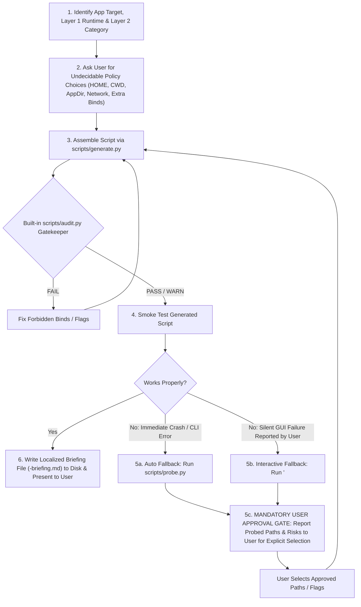

# Bubblewrap Sandbox Generator (`bwrap-sandbox-generator`)

This skill constructs least-privilege, cross-environment portable `bwrap` sandbox wrapper scripts for Linux applications, interactively confirms user-intent isolation policies, enforces strict security auditing against credential leakage and destructive host modifications, and outputs a **Sandbox Security Briefing in the user's own language**.

---

## 1. Decoupled Architecture Overview

To avoid coupling between software taxonomy, shell code, and orchestration scripts, responsibilities are separated across four components:

1. **[`catalog.json`](catalog.json) (Single Source of Truth)**:
   - **`runtimes` (Layer 1 — Execution Environments)**: `native-elf`, `appimage`, `electron`, `wine`, `interpreted`.
   - **`capabilities` (Atomic Hardware & OS Primitives)**: `network`, `display`, `gpu`, `audio`, `input`, `camera`, `usb_serial`, `bluetooth`, `printing`, `optical_storage`, `virtualization_kvm`, `fonts_theme`, `hud`, `dbus`.
   - **`categories` (Layer 2 — Software Taxonomy)**: 23 categories aligned with the **Freedesktop.org Desktop Menu Specification v1.1** (`Main Categories` + `Additional Categories`) and POSIX CLI utility classifications.
   - *Rule*: Never hardcode category or capability definitions in Python scripts. To add or modify a software category, edit `catalog.json` only.

2. **[`presets/`](presets/) (Modular Minimal-Privilege Shell Functions & Templates)**:
   - `presets/base/helpers.sh`: Low-level mount helpers (`bwrap_bind`, `bwrap_ro_bind`, `bwrap_bind_try`, `bwrap_ro_bind_try`, `bwrap_dev_bind_try`, `bwrap_setenv`).
   - `presets/base/core.sh`: Core namespace initialization, read-only rootfs with `/etc/shadow` and `/etc/gshadow` masked to `/dev/null`, configurable sandbox `$HOME` (`isolated`, `cwd`, `app-dir`, `custom`, `ephemeral`), configurable `$PWD` (`none`, `ro`, `rw`) and `APP_DIR` (`ro`, `rw`, `none`) policies, and the `--trace` interactive `strace` wrapper inside `bwrap_exec`.
   - `presets/base/entrypoint.sh`: CLI argument parser supporting runtime overrides (`-n`, `--no-net`, `-i`, `--home-mode`, `--home`, `--home-cwd`, `--home-app-dir`, `--ephemeral`, `-p`, `-w|--cwd-rw`, `--cwd-ro`, `--no-cwd`, `--app-dir-ro`, `--app-dir-rw`, `--no-app-dir`, `-b`, `-ro`, `-d|--dev-bind`, `--bwrap-arg`, `--trace`, `-v`, `-h`).
   - `presets/base/report-template.md`: Structural template for the **Sandbox Security Briefing** (must be localized into the user's language by the Agent).
   - `presets/capabilities/*.sh`: One standalone `.sh` file per capability, defining a single minimal-privilege shell function. All hardware paths use cross-vendor/cross-distro `*-try` mounts (e.g., `gpu.sh` simultaneously includes AMD, Intel, NVIDIA, and Vulkan ICD paths).
   - `presets/runtimes/*.sh`: One standalone `.sh` file per runtime environment.

3. **[`scripts/generate.py`](scripts/generate.py) (Pure Configuration Assembler + Mandatory Audit Gatekeeper)**:
   - Reads `catalog.json`, resolves capabilities (`--category` + `--add-cap` - `--drop-cap`), applies user policy choices (`--home-mode`, `--home-dir`, `--cwd-mode`, `--app-dir-mode`, `--default-net`/`--no-default-net`, `--etc-mode`), and splices the `.sh` preset files together with any user-approved custom mounts (`--ro-bind`, `--bind`, `--dev-bind`) or low-level primitives (`--bwrap-arg`, `--setenv`, `--tmpfs-dir`, `--empty-dir`, `--symlink`).
   - **Built-in Audit Gatekeeper**: Automatically executes `scripts/audit.py` on every generated script before granting `+x` permissions. If `audit.py` returns `FAIL`, `generate.py` strips executable bits (`0600`) and exits with code `1`.
   - Outputs structured `briefing_data` JSON so the Agent can render `presets/base/report-template.md` in the user's language.

4. **[`scripts/audit.py`](scripts/audit.py) (System Integrity & Credential Security Auditor)**:
   - Validates namespace isolation, mandatory security flags (`--die-with-parent`, `--new-session`), `/etc/shadow` masking, and blocks any privilege escalation, destructive host/system modification, persistence injection, or credential exposure.

5. **[`scripts/probe.py`](scripts/probe.py) (Fallback-Only Dynamic Dependency & Risk Probe)**:
   - Invoked **only** when the static preset script fails at runtime or when analyzing a user-recorded `--trace` log.
   - Classifies every discovered host path into `CRITICAL_FORBIDDEN` (`NEVER_BIND`), `HIGH_USER_DATA` (`REQUIRES_EXPLICIT_USER_APPROVAL`), or `NON_PRESET_CUSTOM` (`REQUIRES_EXPLICIT_USER_APPROVAL`).

---

## 2. Step-by-Step Closed-Loop Workflow



### Step 1: Classify the Application & Wrapper Mode (Generic Launcher vs. Dedicated App)
Inspect the user's request (`file <target>` or `python3 scripts/generate.py --list`) and determine:
- **Wrapper Mode**:
  - **Generic / Reusable Category Launcher** (e.g., *"Generate a bwrap script for all Wine games"* or *"Generate a generic sandbox for AppImages"*): Set `--app-id auto` (default) and omit `--target`. At runtime, `bwrap_resolve_app_id` in `core.sh` dynamically derives `<app-id>` from the passed executable name, parent folder name (when the executable is a generic script like `start.sh`/`game.exe`), or launcher env vars (`LUTRIS_GAME_SLUG`, `UMU_ID`, `STEAM_COMPAT_APP_ID`, `-i|--id`), so every program launched through the generic wrapper automatically gets its own isolated `~/.local/share/bwrap-sandbox/<app-id>` (or `<app_dir>/.sandbox-home`), its own `WINEPREFIX`, and its own `app_dir` mount!
  - **Dedicated Single-App Wrapper** (e.g., *"Sandbox `/opt/telegram/Telegram`"*): Set `--app-id "<app-name>"` and `--target "<default-target-path>"`.
- **Layer 1 Runtime (`--runtime`)**: `native-elf`, `appimage`, `electron`, `wine`, or `interpreted`.
- **Layer 2 Category (`--category`)**: Choose one of the 23 Freedesktop-mapped category IDs in `catalog.json`:
  `game`, `game-online`, `emulator`, `web-browser`, `instant-messaging`, `video-conference`, `email-client`, `file-transfer`, `remote-access`, `media-player`, `media-production`, `graphics-2d`, `graphics-3d`, `office-publishing`, `scanning-ocr`, `ide-development`, `science-ai`, `hardware-embedded`, `virtualization`, `desktop-utility`, `cli-pure`, `cli-workspace`, `cli-network`.

### Step 2: Confirm User-Preference Isolation Policies (Interactive Selection)
Certain isolation policies **cannot** be inferred solely from the binary type and depend on the user's personal intent. Unless the user has already specified these in their prompt, **ask the user to choose** (using the `ask_question` tool if available, or a concise question in the user's language, with `(Recommended)` on the sensible default for that app):

1. **Sandbox `$HOME` Mapping Mode (`--home-mode`)**:
   - `isolated` *(Recommended for most GUI/desktop apps & generic launchers)*: Map sandbox `$HOME` to `~/.local/share/bwrap-sandbox/<app-id>` (where `<app-id>` is dynamically derived at runtime when `--app-id auto` is used), keeping each app's configs/saves persistent without polluting the real host `$HOME`.
   - `cwd`: Map sandbox `$HOME` directly to the current working directory (`$PWD`) when launched.
   - `app-dir`: Map sandbox `$HOME` to `<app_dir>/.sandbox-home` inside the runtime target program's own folder (portable / "green software" mode).
   - `custom`: Map sandbox `$HOME` to a specific directory path chosen by the user (`--home-dir <PATH>`).
   - `ephemeral` *(Recommended for pure CLI utilities / untrusted binaries)*: Do not map sandbox `$HOME` to disk at all (`--tmpfs "$HOME"`); all writes are kept in memory and wiped on exit.
2. **Current Working Directory (`$PWD`) Access (`--cwd-mode`)**:
   - `none` *(Recommended for GUI apps/games)*: Do not mount `$PWD` into the sandbox.
   - `ro`: Mount `$PWD` Read-Only (`--ro-bind "$PWD" "$PWD"`).
   - `rw` *(Recommended for `cli-workspace` / compilers / editors)*: Mount `$PWD` Read-Write (`--bind "$PWD" "$PWD"`).
3. **Application Directory (`APP_DIR`) Access (`--app-dir-mode`)** *(Ask when target executables reside in local/user directories outside `/usr`, `/bin`, `/opt`)*:
   - `ro` *(Recommended for security)*: Mount the application's parent directory Read-Only so the binary can read its bundled assets/libs but cannot modify or infect files in its directory.
   - `rw`: Mount the application's parent directory Read-Write (for portable apps or games that write saves, logs, or updates directly into their own program directory).
   - `none`: Do not auto-mount the application's parent directory (mount only the binary file itself).
4. **Network Access Policy (`--default-net` / `--no-default-net`)**:
   - Confirm whether network access should be **Enabled** (`--default-net`) or **Disabled / Offline** (`--no-default-net`, `--unshare-net`) by default.
5. **Additional Shared Host Directories / `/etc` Hardening (Optional)**:
   - Ask if the user needs specific host folders bound (e.g., `~/Documents`, `~/Downloads`, or a custom `WINEPREFIX`), and whether `/etc` should use standard `compat` mode (default) or hardened `minimal` mode (`--etc-mode minimal`).

### Step 3: Generate the Sandbox Script
Run `scripts/generate.py` with the classified presets and user-selected policies (use `--app-id auto` and omit `--target` for generic reusable launchers):
```bash
python3 /home/tale/workspace/playground/.agents/skills/bwrap-sandbox-generator/scripts/generate.py \
  --app-id "<auto-or-app-name>" \
  --runtime "<runtime-id>" \
  --category "<category-id>" \
  --home-mode "<isolated|cwd|app-dir|custom|ephemeral>" \
  --cwd-mode "<none|ro|rw>" \
  --app-dir-mode "<ro|rw|none>" \
  -o "<output-script-path>" \
  --report "<output-briefing-path.md>"
```
`generate.py` automatically runs `scripts/audit.py` before marking `<output-script-path>` executable, and returns `expected_report_file` (defaulting to `<output-script-stem>-briefing.md` alongside the generated script) and `briefing_data` in JSON.

### Step 4: Verify Execution (Smoke Test)
Test-run the generated script (`<output-script-path> --help` or launch test). If it works, proceed to **Step 6**.

### Step 5: Fallback Probing & Mandatory User Approval Gate (ONLY If Static Presets Fail)
Never run `probe.py` before testing the static preset script first.

- **Path 5A — Automatic Trigger (Immediate Crash / Non-Zero Exit / Missing Library or Path)**:
  ```bash
  python3 /home/tale/workspace/playground/.agents/skills/bwrap-sandbox-generator/scripts/probe.py \
    ldd-nonstd "<target-binary>"
  <output-script-path> --trace /tmp/<app-name>.strace <app-args...>
  python3 /home/tale/workspace/playground/.agents/skills/bwrap-sandbox-generator/scripts/probe.py \
    trace-analyze /tmp/<app-name>.strace
  ```
- **Path 5B — User-Feedback Trigger (Silent GUI Failure / Interactive Feature Broken)**:
  Instruct the user to reproduce the issue using `--trace`, then parse the trace log:
  ```bash
  <output-script-path> --trace /tmp/<app-name>.strace <app-args...>
  python3 /home/tale/workspace/playground/.agents/skills/bwrap-sandbox-generator/scripts/probe.py \
    trace-analyze /tmp/<app-name>.strace
  ```
- **Path 5C — Mandatory User Review & Approval Gate (CRITICAL SECURITY RULE)**:
  > **NEVER autonomously bind non-preset paths discovered by `probe.py`!**
  > While a legitimate application (such as an Office suite) may request access to `~/Documents`, a malicious or compromised binary could wipe, corrupt, or exfiltrate all files in `~/Documents`.
  1. **Filter Out `CRITICAL_FORBIDDEN` Paths**: Never propose or bind paths classified as `CRITICAL_FORBIDDEN` (`~/.ssh`, `~/.gnupg`, `~/.bashrc`, `docker.sock`, `/etc/shadow`, etc.).
  2. **Report All Candidate Non-Preset Paths & Primitives to the User**: List every candidate path, its requested access mode (`--ro-bind`, `--bind`, or `--dev-bind`), its risk classification (`HIGH_USER_DATA` vs `NON_PRESET_CUSTOM`), and why the application requested it.
  3. **Require Explicit User Selection**: Ask the user which specific paths or capabilities they authorize binding into the sandbox so the user explicitly assumes the risk.
  4. **Re-Run `generate.py` with User-Approved Options Only** (`--add-cap`, `--ro-bind`, `--bind`, `--dev-bind`, `--bwrap-arg`, `--setenv`), which automatically re-runs `scripts/audit.py`.

### Step 6: Write Localized Sandbox Security Briefing File to Disk & Present to User (MANDATORY)
> **CRITICAL REQUIREMENT — BOTH FILE CREATION AND USER-LANGUAGE LOCALIZATION ARE MANDATORY**:
> 1. **Read Template & Data**: Read [`presets/base/report-template.md`](presets/base/report-template.md) and populate it using the `briefing_data` JSON returned by `generate.py`.
> 2. **Localize into User's Language**: You **MUST** write the entire Sandbox Security Briefing (all section titles, table headers, policy explanations, capability descriptions, audit findings, and CLI cheatsheet comments) in the **EXACT language used by the user** (e.g., Simplified Chinese if the user asked in Chinese; English if the user asked in English).
> 3. **Write Briefing File to Disk (`expected_report_file`)**: You **MUST** save the localized Markdown briefing to disk at the `expected_report_file` path returned by `generate.py` (by default `<output-script-stem>-briefing.md` in the same directory as the generated `.sh` script). **Never** only print the briefing in chat without writing the `.md` file to disk!
> 4. **Link in Response**: Provide clickable links to both the generated sandbox script and the saved Sandbox Security Briefing `.md` file in your response to the user.

---

## 3. Security Audit Protection Matrix (`scripts/audit.py`)

`scripts/audit.py` enforces strict checks against both **destructive host/system modifications** and **credential/secret leakage**:

- **System Root & Binary Integrity (`FAIL`)**: Blocks read-write mounts (`--bind` / `--dev-bind`) on `/`, `/usr`, `/etc`, `/boot`, `/bin`, `/sbin`, `/lib*`, `/opt`, `/var`, `/root`, `/proc`, `/sys`.
- **Raw Disk, Memory & Firmware Protection (`FAIL`)**: Blocks raw block devices (`/dev/sd*`, `/dev/nvme*`, `/dev/vd*`, `/dev/mmcblk*`, `/dev/loop*`, `/dev/dm-*`, `/dev/md*`, `/dev/mapper/*`), `/dev/mem`, `/dev/kmem`, `/dev/port`, `/dev/tpm*`, `/sys/firmware/efi/efivars`, and full `/dev` passthrough.
- **Linux Capability Escalation (`FAIL`)**: Blocks `--cap-add ALL`, `CAP_SYS_ADMIN`, `CAP_SYS_PTRACE`, `CAP_SYS_MODULE`, `CAP_SYS_RAWIO`, `CAP_DAC_OVERRIDE`, `CAP_DAC_READ_SEARCH`, `CAP_SETUID`, `CAP_SETGID`.
- **Host Persistence & Autostart Escape (`FAIL`)**: Blocks `~/.bashrc`, `~/.bash_profile`, `~/.zshrc`, `~/.profile`, `~/.bash_history`, `~/.zsh_history`, `~/.config/autostart`, `~/.config/systemd`, `~/.local/share/systemd`, `/var/spool/cron`.
- **Container & Hypervisor Daemon Sockets (`FAIL`)**: Blocks `docker.sock`, `podman.sock`, `containerd.sock`, `crio.sock`, `libvirt-sock`, `lxd/unix.socket`, `incus/unix.socket`.
- **Credentials, Keyrings & Host Browser Profiles (`FAIL`)**: Blocks `~/.ssh`, `~/.gnupg`, `SSH_AUTH_SOCK`, `~/.aws`, `~/.kube`, `~/.config/gcloud`, `~/.azure`, `~/.config/gh`, `~/.git-credentials`, `~/.netrc`, `~/.npmrc`, `~/.pypirc`, `~/.cargo/credentials*`, `~/.docker/config.json`, `~/.config/containers/auth.json`, `~/.config/rclone`, `~/.vault-token`, `~/.terraform.d`, `~/.password-store`, `~/.local/share/keyrings`, `~/.local/share/kwalletd`, `/run/user/*/keyring`, host browser profiles (`~/.mozilla`, `~/.config/google-chrome`, `~/.config/chromium`, `~/.config/BraveSoftware`, `~/.config/vivaldi`, `~/.config/microsoft-edge`), `/etc/sudoers*`, and verifies `/etc/shadow` & `/etc/gshadow` are masked with `/dev/null`.
- **Personal User Data Directories (`WARN`)**: Flags `~/Documents`, `~/Downloads`, `~/Desktop`, `~/Pictures`, `~/Videos`, `~/Music`, `~/Work`, `~/Projects`, `~/workspace` to verify explicit user approval.
